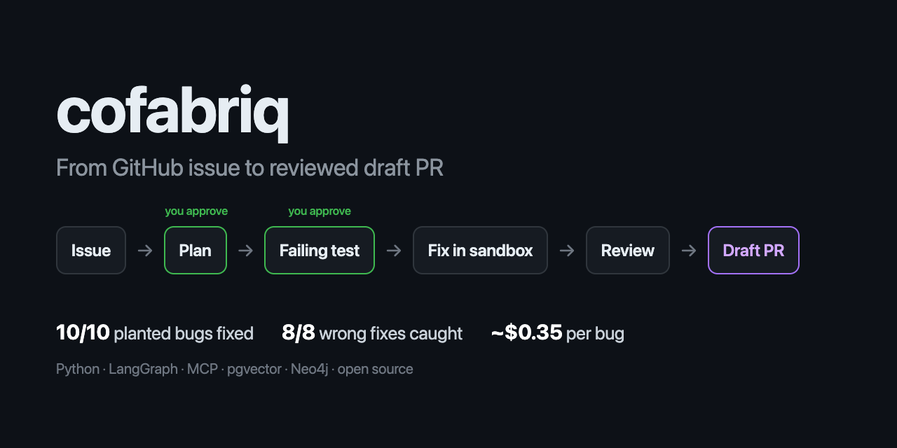
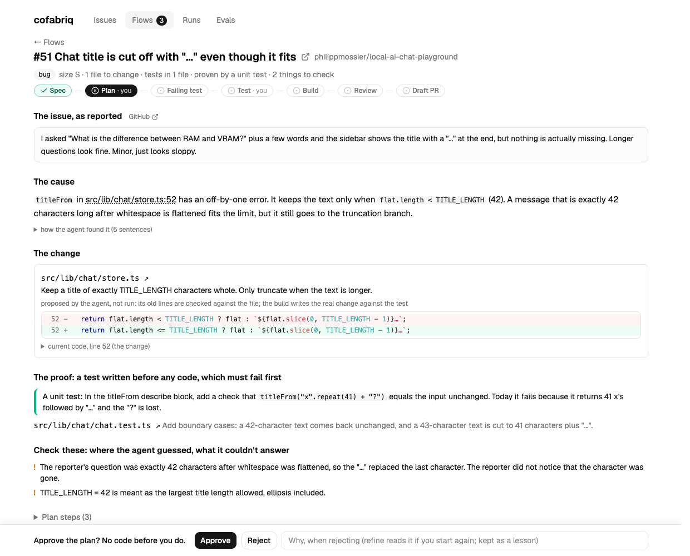
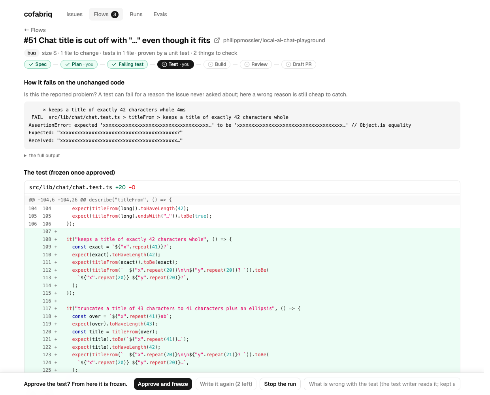
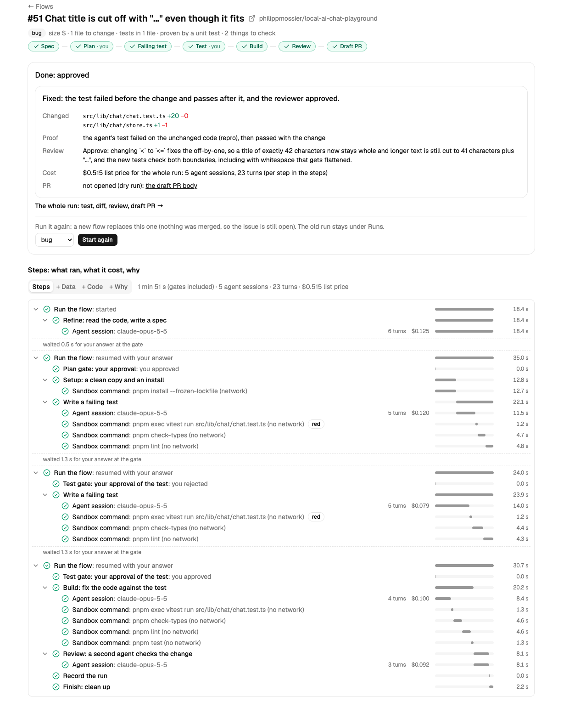

# cofabriq

[](https://github.com/philippmossier/cofabriq/actions/workflows/check.yml)

From a GitHub issue to a reviewed draft PR, with you approving the two
decisions that matter. A tool devs point at their repo, not a review queue.



You approve the plan and the failing test, an agent fixes the code in a
sandbox, and a second agent reviews it. You get a draft PR and nothing is
merged for you. Tried on a demo app with bugs planted on purpose.

[Quickstart](#quickstart)

## Demo

Playground [#51](https://github.com/philippmossier/local-ai-chat-playground/issues/51):
a chat title is cut off with "…" although it fits. Started from the Issues
page, done in 1 min 51 s for $0.52 (API list price), one test sent back on
the way.

**The plan gate.** The cause in two sentences, the change as a diff checked
against the file, and how the fix will be proven. No code is written before
you approve.



**The test gate.** How the new test fails on the unchanged code, then the
test. The first one was sent back with "also cover a title that is 43
characters long"; this is the second. Once approved it is frozen: the
agent that fixes the code can't change it.



**The result, step by step.** What changed, the proof, the review and the
cost, then every step with its time, turns and cost: each agent session,
each sandbox command, each gate and how long it waited for you.



## How it works: one real bug

What happens to one real bug report. A user filed
[#54](https://github.com/philippmossier/local-ai-chat-playground/issues/54):

> I wrote something at 11:50 PM and checked again at 12:10 AM. The message
> says "Today 11:50 PM". It was yesterday.

The dev presses Start on it (or runs `cofabriq run 54`, as here):

1. **An agent reads the code and explains the bug.** The app counts 24-hour
   periods since the message, not calendar days: 20 minutes after midnight
   is less than a day, so it says "Today". Its plan: compare the two dates'
   midnights instead.
2. **The dev approves the plan.** No code is written before that.
3. **An agent writes a test that fails on the bug:** a message from 23:50,
   seen at 00:10, must say "Yesterday". It fails, so the bug is real.
4. **An agent fixes the code until that test passes.** It can't change the
   test. The project's own checks (types, lint, all tests) run in an
   isolated container.
5. **A second agent reviews the fix** without the first one's reasoning. It
   can stop the PR only by writing a test that fails on the fix.
6. **The dev gets a draft PR** with the plan, the test and the review, and
   decides whether to merge it. Example:
   [#75](https://github.com/philippmossier/local-ai-chat-playground/pull/75).

About 2 minutes and $0.35 for this bug.

> <details><summary><b>Show the real output of each step</b> (the same run, shortened)</summary>
>
> **1. The agent's spec**, shown to the dev:
>
> ```text
> problem
>   `messageTime` in src/lib/chat/time.ts:10 computes `days = Math.floor((now - at) / DAY)`.
>   That number is the elapsed time divided by 24 h. A message sent at 23:50 and viewed
>   at 00:10 the next day is 20 minutes old, so `days = 0` [...]
> plan
>   1. In src/lib/chat/time.ts, add a helper that returns local midnight for a timestamp.
>   2. Replace line 10 with days = Math.round((startOfDay(now) - startOfDay(at)) / DAY).
>   [...]
> open questions
>   Did the reporter reload the page, or was the tab left open across midnight? [...]
> ```
>
> **2. The plan gate:**
>
> ```text
> Approve the plan and let the agent edit? [y/N]: y
> ```
>
> **3. The agent's test**, and how it fails on the current code:
>
> ```ts
> it("a message just before midnight is yesterday", () => {
>   expect(messageTime(at(9, 4, 23, 50), earlyMonday, "en")).toMatch(/^Yesterday 11:50\sPM$/);
> });
> ```
>
> ```text
> AssertionError: expected 'Today 11:50 PM' to match /^Yesterday 11:50\sPM$/
> Tests  4 failed | 5 passed (9)
> ```
>
> **4. The fix**, then the project's checks, run in a container:
>
> ```diff
> -  const days = Math.floor((now - at) / DAY);
> +  // Calendar days in local time; Math.round absorbs 23 h / 25 h DST days.
> +  const days = Math.round((startOfDay(now) - startOfDay(at)) / DAY);
> ```
>
> ```text
> fix 1  agent $0.047 5 turns 10 s | repro:ok(1s) types:ok(5s) lint:ok(4s) test:ok(2s)
> ```
>
> **5. The review:**
>
> ```text
> review   approved ($0.053 4 turns 10 s)
>          Approve: the change counts local calendar days for both the Today/Yesterday
>          and weekday cutoffs, as the spec asks [...]
>          nit src/lib/chat/time.test.ts:31: Plan step 4 mentions DST-independent tests,
>          but no case crosses a DST change. [...]
> ```
>
> **6. The top of the draft PR body:**
>
> ```markdown
> Fixes #54.
>
> - **Risk: low** (chat)
> - **Review: approved.** Approve: the change counts local calendar days [...]
> - **Checks:** the test was red before the change; repro, types, lint, test green after
>
> ### Plan (approved before any code)
> ```
>
> </details>

## Numbers

On the demo app: 10 planted logic bugs, 12 planted UI bugs, 9 features
removed on purpose.

| | |
| --- | --- |
| logic bugs fixed, with the agent's own failing test first | 10/10, all on the first try |
| UI bugs fixed, with the agent's own browser test first | 12/12, 11 on the first try |
| features built against a frozen acceptance test | 9/9, all on the first try |
| features whose original (hidden) tests pass on the result | 9/9 |
| right fixes let through by the review gate | 10/10 |
| wrong fixes caught by the review gate and repaired before the PR | 8/8 |
| cost per bug or feature, end to end | about $0.20-0.35 |

The wrong fixes were written wrong on purpose (an agent told to make a
plausible but wrong fix), since the loop itself made none. Early and easy:
small changes in a small repo, one model in every role. Of the 12 browser
tests, 3 also needed a neighbouring planted bug fixed, and the agent fixed
it on the way. Details and caveats: [docs/evals.md](docs/evals.md).

## Quickstart

On the demo app, a small local-first chat app with seeded issues. Read-only:
nothing is written to GitHub, the draft PR body stays on your disk.

Needs [uv](https://docs.astral.sh/uv/), [pnpm](https://pnpm.io/), Podman
with compose, the [`claude`](https://docs.anthropic.com/en/docs/claude-code)
CLI on the PATH, an Anthropic API key and a fine-grained GitHub token with
"Public repositories (read-only)" and no other permission. For your own
runs the agent can use your Claude plan instead of the key:
`AGENT_AUTH=subscription` and a token from `claude setup-token` (see
`.env.example`); costs shown are then API list prices, not billed.

```bash
make setup     # Python and UI deps, .env from .env.example: set GITHUB_TOKEN, ANTHROPIC_API_KEY
make up        # Postgres (a run waits there at its gates), Neo4j, Jaeger
uv run cofabriq fetch-issues --repo philippmossier/local-ai-chat-playground
make ui && uv run cofabriq serve --write     # open the URL it prints once
```

Under Issues, pick a bug (#51 is the one above) and press Start:

1. The issue is read fresh from GitHub, refused if it has an open blocker,
   then an agent reads the code and writes the spec. The step view shows
   it live.
2. Approve the plan, or reject it with a reason.
3. The agent writes a failing test and the page shows how it fails:
   approve it, have it written again with your reason, or stop the run.
4. Build, checks, review and the draft PR body run on their own. The
   result stays under Runs.

About 2 minutes and $0.35 to $0.55 per bug (API list price). A run stops
at its budget (`RUN_BUDGET_USD`, $3 by default), and `uv run cofabriq stop`
halts every agent before its next step.

## Your own repo

cofabriq never writes to your GitHub, and the loop on your code needs no
token at all. There are three places, and the page shows them where you
decide:

```
~/code/myapp                          your folder: cofabriq only reads it
<cofabriq>/data/clones/acme-myapp     cofabriq's copy: the agent works here
GitHub                                never written; read only to import issues
```

1. `make ui && uv run cofabriq serve --write`, open the URL it prints, then
   Repos: the path of your clone, Add a repo. cofabriq clones your folder
   into its own copy, and an agent reads the manifests, Makefile and CI
   there. It proposes the container image and the commands to install,
   check and test, each with the file and line it came from (one agent
   session, about $0.10).
2. Read and edit the file on the page: nothing has run yet. Check runs it
   in a sandbox on your branch: the install (the only step with network),
   every check, and per test suite a canary test that must fail and one
   that must pass. A suite that can't go red would make every frozen test
   worthless. A failed check: fix the file, or "Propose again with this
   failure" (twice at most). On 6 repos the prompt never saw, the first
   proposal was proven as written on 2, and 5 after proposing again
   ([evals](docs/evals.md)).
3. Proven, the repo is under Issues: write a local ticket (it stays on your
   machine) or import its open issues, then Start.
4. The result comes back as a branch in cofabriq's copy and as a patch. The
   card's command fetches it into your folder; you push it yourself.

The CLI does the same: `repo add <path>`, `repo check <owner/name>`,
`ticket new "<title>"`.

| What | Token | Permissions |
| --- | --- | --- |
| your code, a run, its result | none | cofabriq reads your local clone |
| importing open issues | `GITHUB_TOKEN`, fine-grained | Issues and Metadata, read-only, on that repo |
| or `gh`'s login | `GITHUB_TOKEN_FROM_GH=true` | opt-in, with a warning when it can write |
| a draft PR (`--apply`) | `GITHUB_WRITE_TOKEN` | the demo app only, checked in code |

What the sandbox can't do: services (a check that needs a database is left
out and the notes say so), git, and a non-root user.

## Why it is built this way

- **The dev stays in charge.** Autopilot only takes small, low-risk issues;
  the dev approves every plan before code exists and every PR before it is
  merged. One issue, one dev, one branch, one draft PR.
- **A claim isn't evidence, a failing test is.** In a timed review of 10
  draft PRs, 3 of them wrong, the AI reviewer had flagged all 3 and I still
  merged 2 (one reviewer who skimmed without testing locally, so an
  anecdote, not an eval): after a few green PRs a prose warning stops registering. So a
  reviewer can only block a PR with a test that fails on it
  ([ADR-008](docs/adr/008-only-a-red-test-blocks.md)). When it asks for
  changes, every concern it raises gets that chance, not only the ones it
  labels blockers: a wrong fix once slipped through as a "concern".
- **Safe on public repos.** Issue text is untrusted input. Code the agent
  writes runs only in a container without network
  ([ADR-007](docs/adr/007-agent-written-code-runs-only-in-a-sandbox.md)).
  The only write to GitHub is one branch and a draft PR, on an explicit
  `--apply`, with a scoped token. `cofabriq stop` halts every agent before
  its next step; a run has a budget and every agent a turn cap. A target's
  own contract (on the demo app: its privacy promise) is checked in code on
  every change.
- **A number per stage.** Every agent or retrieval change is measured
  ([evals](docs/evals.md)).

## More

- [What each version added](docs/versions.md), one real example each:
  features against a frozen acceptance test, UI bugs with a browser test,
  a ticket from a fuzzy note, rules from what went wrong, the app's
  contract checked in code, and triage (duplicates with a quote as
  evidence, missing info with a reply draft, measured on
  [microsoft/vscode](https://github.com/microsoft/vscode) and
  [open-webui](https://github.com/open-webui/open-webui)).
- How each part works: [docs/how-it-works.md](docs/how-it-works.md); a map
  of the repository, the parts and the user journeys:
  [docs/architecture.md](docs/architecture.md).

## Headless: the CLI

Everything the browser does also runs in the terminal, and a few things
only run there so far:

```bash
uv run cofabriq run 54             # one process: refine, gates answered here, fix, review, PR body (dry run)
uv run cofabriq run <n> --type feature   # a feature request: criteria, a frozen acceptance test, the build
uv run cofabriq flow start 51      # what Start does: stops at the plan gate, the run waits in Postgres
uv run cofabriq flow resume 51 --approve # or --reject --reason "...", at either gate
uv run cofabriq flow show 51 --steps     # where it is, every step with time and cost
uv run cofabriq refine 54 --repo philippmossier/local-ai-chat-playground   # the spec only
uv run cofabriq intake 83 84       # which tickets are ready, blocked or waiting
uv run cofabriq lessons --propose  # rules for the target's CLAUDE.md from what went wrong
uv run cofabriq stop               # the kill switch; stop --clear lifts it
```

`--repo owner/name` picks the repo (the playground by default; `refine`
and `triage` use `TARGET_REPO` from `.env`).
`run --apply` opens the draft PR on GitHub (needs `GITHUB_WRITE_TOKEN`,
playground only, checked in code). Triage needs `OPENAI_API_KEY` and the
issues embedded first: `embed-issues --repo <r>`, then `triage <n> --repo
<r>`. From a rough note to a ticket: `ln -s "$PWD/skills/ticket"
~/.claude/skills/ticket`, then `/ticket <note>` in your own Claude Code
session ([intake](docs/intake.md)). Every command:
`uv run cofabriq --help`.

Development: `make check` runs ruff, pyright (strict) and pytest, and the
UI's checks when `ui/` changed. `make e2e` runs the viewer in a browser on
recorded runs (seconds, free, in CI); `make journey` takes one live issue
through the real UI and saves every page to review.

## Roadmap

- [x] **0.1** triage: duplicates, missing info, a route per issue
- [x] **0.2** the core loop: plan, failing test, fix, review gate, draft PR
- [x] **0.3** small features: acceptance criteria, a test frozen before
      code, intake of tickets, the read-only viewer
- [x] **0.4** UI bugs in the loop (a browser in the sandbox), a kill switch
- [x] **0.5** approve plans and tests in the browser; from a fuzzy idea to
      a ticket
- [x] **0.6** rules from what went wrong, the app's contract checked in
      code, screenshots as evidence, a harder planted set
- [x] **0.7** better duplicate retrieval: issues cleaned before embedding,
      an LLM rerank of the nearest 50
- [x] **0.8** runs started and followed in the browser, step by step with
      time and cost; a test gate on every run, a test sent back is written
      again; how each fix will be proven; 0.8.1: the plan gate reworked, the
      planned test as cases
- [ ] **Next:** a second reviewer model, "who knows this area" for risky
      changes, publishing runs from the browser
- [ ] **Later:** a real repository with tests, self-host packaging

0.x releases: the CLI may still change. Decisions are recorded in
[`docs/adr/`](docs/adr/) as they are made.

## How this is built

With Claude Code as a pair programmer. Architecture, scope and trade-offs are
mine and written down as ADRs; every change is reviewed before it lands.
