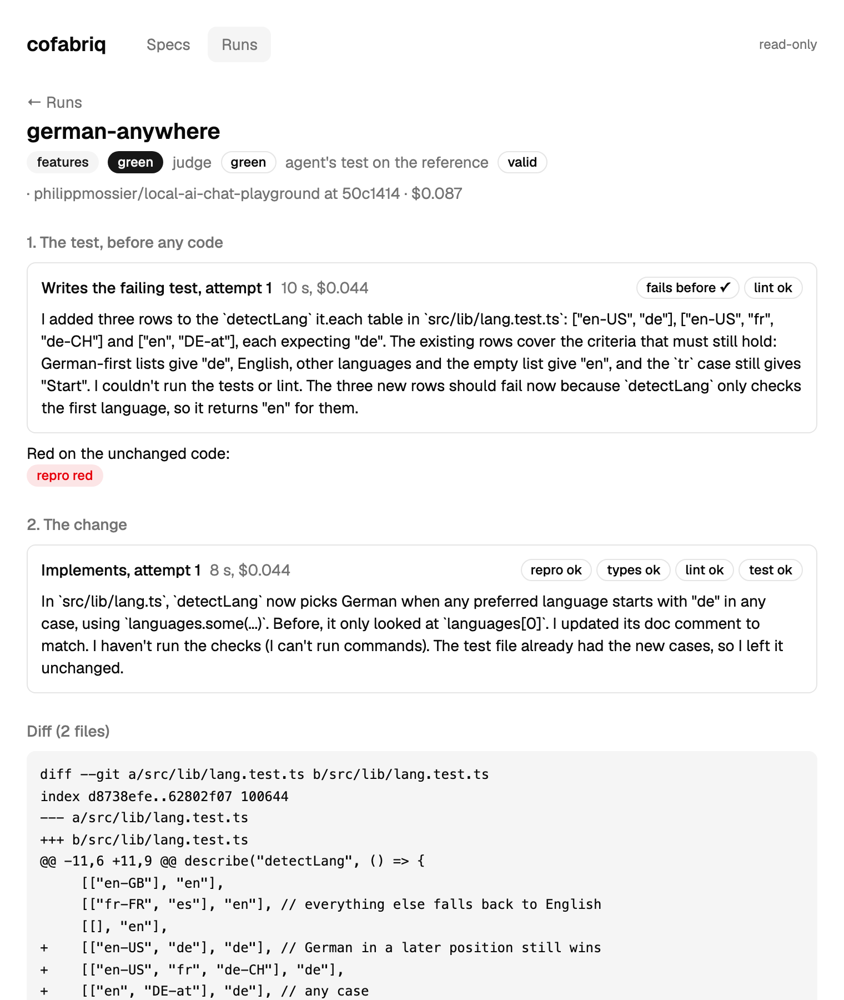

# cofabriq

An agentic software factory that devs use as a tool, not a review queue for them.

Small, low-risk issues go through **autopilot**: triaged, implemented, gated
by the repository's own CI, reviewed and handed to the dev as a draft PR.
Features go the same way once their acceptance criteria are approved: the
agent writes the acceptance test first, and it is frozen before any code.
Today, in 0.4: bug reports and small feature requests to a draft PR,
including bugs that only show in a browser, tried on a demo app with bugs
planted and features removed on purpose, and a viewer that shows every
step.

What happens to one real bug report. A user filed
[#54](https://github.com/philippmossier/local-ai-chat-playground/issues/54):

> I wrote something at 11:50 PM and checked again at 12:10 AM. The message
> says "Today 11:50 PM". It was yesterday.

The dev runs `cofabriq run 54`:

1. **An agent reads the code and explains the bug.** The app counts 24-hour
   periods since the message, not calendar days: 20 minutes after midnight
   is less than a day, so it says "Today". Its plan: compare the two dates'
   midnights instead.
2. **The dev approves the plan.** No code is written before that.
3. **An agent writes a test that fails on the bug:** a message from 23:50,
   seen at 00:10, must say "Yesterday". It fails, so the bug is real.
4. **An agent fixes the code until that test passes.** It can't change the
   test. The project's own checks (types, lint, all tests) run in an
   isolated container.
5. **A second agent reviews the fix** without the first one's reasoning. It
   can stop the PR only by writing a test that fails on the fix.
6. **The dev gets a draft PR** with the plan, the test and the review, and
   decides whether to merge it. Example:
   [#80](https://github.com/philippmossier/local-ai-chat-playground/pull/80).

About 2 minutes and $0.35 for this bug.

> <details><summary><b>Show the real output of each step</b> (the same run, shortened)</summary>
>
> **1. The agent's spec**, shown to the dev:
>
> ```text
> problem
>   `messageTime` in src/lib/chat/time.ts:10 computes `days = Math.floor((now - at) / DAY)`.
>   That number is the elapsed time divided by 24 h. A message sent at 23:50 and viewed
>   at 00:10 the next day is 20 minutes old, so `days = 0` [...]
> plan
>   1. In src/lib/chat/time.ts, add a helper that returns local midnight for a timestamp.
>   2. Replace line 10 with days = Math.round((startOfDay(now) - startOfDay(at)) / DAY).
>   [...]
> open questions
>   Did the reporter reload the page, or was the tab left open across midnight? [...]
> ```
>
> **2. The plan gate:**
>
> ```text
> Approve the plan and let the agent edit? [y/N]: y
> ```
>
> **3. The agent's test**, and how it fails on the current code:
>
> ```ts
> it("a message just before midnight is yesterday", () => {
>   expect(messageTime(at(9, 4, 23, 50), earlyMonday, "en")).toMatch(/^Yesterday 11:50\sPM$/);
> });
> ```
>
> ```text
> AssertionError: expected 'Today 11:50 PM' to match /^Yesterday 11:50\sPM$/
> Tests  4 failed | 5 passed (9)
> ```
>
> **4. The fix**, then the project's checks, run in a container:
>
> ```diff
> -  const days = Math.floor((now - at) / DAY);
> +  // Calendar days in local time; Math.round absorbs 23 h / 25 h DST days.
> +  const days = Math.round((startOfDay(now) - startOfDay(at)) / DAY);
> ```
>
> ```text
> fix 1  agent $0.047 5 turns 10 s | repro:ok(1s) types:ok(5s) lint:ok(4s) test:ok(2s)
> ```
>
> **5. The review:**
>
> ```text
> review   approved ($0.053 4 turns 10 s)
>          Approve: the change counts local calendar days for both the Today/Yesterday
>          and weekday cutoffs, as the spec asks [...]
>          nit src/lib/chat/time.test.ts:31: Plan step 4 mentions DST-independent tests,
>          but no case crosses a DST change. [...]
> ```
>
> **6. The top of the draft PR body:**
>
> ```markdown
> Fixes #54.
>
> - **Risk: low** (chat)
> - **Review: approved.** Approve: the change counts local calendar days [...]
> - **Checks:** the test was red before the change; repro, types, lint, test green after
>
> ### Plan (approved before any code)
> ```
>
> </details>

## Features (0.3)

The same loop takes a small feature request. One of the demo app's
features was taken out on purpose, and its ticket asks for it back:

> My browser languages are English (US) first and German second. The app
> shows English because only the first language counts. I can read both,
> but I'd prefer German.

1. **An agent reads the code and writes acceptance criteria**, each one a
   behaviour a test can check: `detectLang(["en-US", "de"])` returns
   `"de"`; `detectLang(["en", "DE-at"])` returns `"de"` (any case); German
   first, English, other languages and the empty list stay as they are.
   Seven in all.
2. **The dev approves the plan and the criteria.** A spec that names no
   testable criterion, a file that doesn't exist or a size too big for one
   PR goes back to the dev with the reason; open questions are answered
   at this gate.
3. **An agent writes the acceptance test from the criteria:** three new
   rows in the existing `detectLang` table. It fails on the current code,
   so it tests something. **From here it is frozen:** the agent that
   builds the feature can't change it.
4. **An agent builds the feature** (one line: `languages.some(...)`
   instead of `languages[0]`) until the test and the project's checks are
   green.
5. **The review gate and the draft PR** as for bugs (in `cofabriq run`;
   the feature evals stop at the build, so the gate isn't measured on
   features yet).

About 2 minutes and $0.25 (API list price) for this feature. The feature's own original
tests, hidden from the agents, pass on the result.



**The viewer** (`cofabriq serve`, read-only, local): every spec with its
criteria and readiness, every run from the failing test to the review
gate's proofs and the PR body. Self-hosted by design: it runs where the
code is, with your keys ([ADR-009](docs/adr/009-self-hosted-not-saas-ui-in-the-repo.md)).

## UI bugs (0.4)

Some bugs only show in a browser. A user filed this one:

> The placeholder says Shift+Enter for a new line, but Shift+Enter sends
> the message immediately. I wanted to paste a list with line breaks.

The agent writes its failing test as a browser test this time, run by
Playwright in the same isolated container, against the app on a fake
model:

```ts
test("Shift+Enter breaks the line instead of sending", async ({ page }) => {
  // ...
  await box.fill("first line");
  await box.press("Shift+Enter");
  await box.pressSequentially("second line");
  await expect(box).toHaveValue("first line\nsecond line");
  await expect(page.getByText(/Fake answer to:/)).toHaveCount(0);
  // ...
});
```

It fails on the current code, the fix is one condition (`!e.shiftKey`),
and the bug's own hidden test passes on it. About 2 minutes and $0.17
(API list price). A target names its test kinds (unit tests for logic,
browser tests for the UI) and the agent picks the one that can show the
bug.

## Why it is built this way

- **The dev stays in charge.** Autopilot only takes small, low-risk issues;
  the dev approves every plan before code exists and every PR before it is
  merged. One issue, one dev, one branch, one draft PR.
- **A claim isn't evidence, a failing test is.** In a timed review of 10
  draft PRs, 3 of them wrong, the AI reviewer had flagged all 3 and I still
  merged 2: after a few green PRs a prose warning stops registering. So a
  reviewer can only block a PR with a test that fails on it
  ([ADR-008](docs/adr/008-only-a-red-test-blocks.md)). When it asks for
  changes, every concern it raises gets that chance, not only the ones it
  labels blockers: a wrong fix once slipped through as a "concern".
- **Safe on public repos.** Issue text is untrusted input. Code the agent
  writes runs only in a container without network
  ([ADR-007](docs/adr/007-agent-written-code-runs-only-in-a-sandbox.md)).
  The only write to GitHub is one branch and a draft PR, on an explicit
  `--apply`, with a scoped token. `cofabriq stop` halts every agent before
  its next step; a run has a budget and every agent a turn cap.
- **A number per stage.** Every agent or retrieval change is measured
  ([evals](docs/evals.md)).

## Numbers

On the demo app: 10 planted logic bugs, 12 planted UI bugs, 9 features
removed on purpose.

| | |
| --- | --- |
| logic bugs fixed, with the agent's own failing test first | 10/10, all on the first try |
| UI bugs fixed, with the agent's own browser test first | 12/12, 11 on the first try |
| features built against a frozen acceptance test | 9/9, all on the first try |
| features whose original (hidden) tests pass on the result | 9/9 |
| right fixes let through by the review gate | 10/10 |
| wrong fixes caught by the review gate and repaired before the PR | 8/8 |
| cost per bug or feature, end to end | about $0.20-0.35 |

The wrong fixes were written wrong on purpose (an agent told to make a
plausible but wrong fix), since the loop itself made none. Early and easy:
small changes in a small repo, one model in every role. Of the 12 browser
tests, 3 also needed a neighbouring planted bug fixed, and the agent fixed
it on the way. Details and caveats: [docs/evals.md](docs/evals.md).

## Triage (0.1)

Before any of that, an issue gets a triage card: type, component, a
duplicate verdict with a quote as evidence, missing info with a reply
draft for the reporter. Measured on real issues of
[microsoft/vscode](https://github.com/microsoft/vscode) and
[open-webui](https://github.com/open-webui/open-webui).


How each part works: [docs/how-it-works.md](docs/how-it-works.md).

## Quickstart

Requires [uv](https://docs.astral.sh/uv/), Podman (or Docker) with compose,
an OpenAI key and a fine-grained GitHub token with "Public repositories
(read-only)" and no other permission. Without `run --apply`, cofabriq
never writes to GitHub.

```bash
make setup               # install deps, create .env (set OPENAI_API_KEY, GITHUB_TOKEN)
make up                  # Postgres + pgvector (5433), Neo4j (7474, 7687), test Neo4j (7688)
uv run cofabriq health   # OK per service
```

Triage an issue on the playground (a small local-first chat app with
seeded issues):

```bash
REPO=philippmossier/local-ai-chat-playground
git clone https://github.com/$REPO ../local-ai-chat-playground
uv run cofabriq fetch-issues --repo $REPO    # all issues -> data/issues/ (read-only, incremental)
uv run cofabriq embed-issues --repo $REPO    # title + body into pgvector: the duplicate candidates
uv run cofabriq fetch ../local-ai-chat-playground && uv run cofabriq embed   # docs, for "related docs"
uv run cofabriq triage 11 --repo $REPO       # add --json for the raw card
```

Run the loop on a playground issue (needs an Anthropic key, the
[`claude`](https://docs.anthropic.com/en/docs/claude-code) CLI on the PATH
and Podman; about $0.35 per issue):

```bash
uv run cofabriq refine 54 --repo $REPO     # the spec only: read-only agent, prints it
uv run cofabriq run 54 --repo $REPO        # refine, plan gate, repro, fix, review gate, PR body (dry run)
uv run cofabriq run <n> --type feature     # a feature request: criteria, test gate, then the build
```

Look at the specs and runs in the browser:

```bash
cd ui && pnpm install && cd ..
make ui && uv run cofabriq serve           # http://127.0.0.1:8765, read-only
```

`--apply` opens the draft PR on GitHub (needs `GITHUB_WRITE_TOKEN`,
playground only). For your own runs, the agent can use your Claude plan
instead of the key: `AGENT_AUTH=subscription` and a token from
`claude setup-token` (see `.env.example`); costs shown are then API list
prices, not billed.

Development: `make check` runs ruff, pyright (strict) and pytest, and the
UI's checks when `ui/` changed.

## Roadmap

- [x] **0.1** triage: duplicates, missing info, a route per issue
- [x] **0.2** the core loop: plan, failing test, fix, review gate, draft PR
- [x] **0.3** small features: acceptance criteria, a test frozen before
      code, intake of tickets, the read-only viewer
- [x] **0.4** UI bugs in the loop (a browser in the sandbox), a kill switch
- [ ] **0.5** approve plans and tests in the browser; from a fuzzy idea to
      a ticket
- [ ] **0.6** a real repository with tests
- [ ] **Later:** self-host packaging, a second reviewer model, learning
      from past runs

0.x releases: the CLI may still change. Decisions are recorded in
[`docs/adr/`](docs/adr/) as they are made.

## How this is built

With Claude Code as a pair programmer. Architecture, scope and trade-offs are
mine and written down as ADRs; every change is reviewed before it lands.
