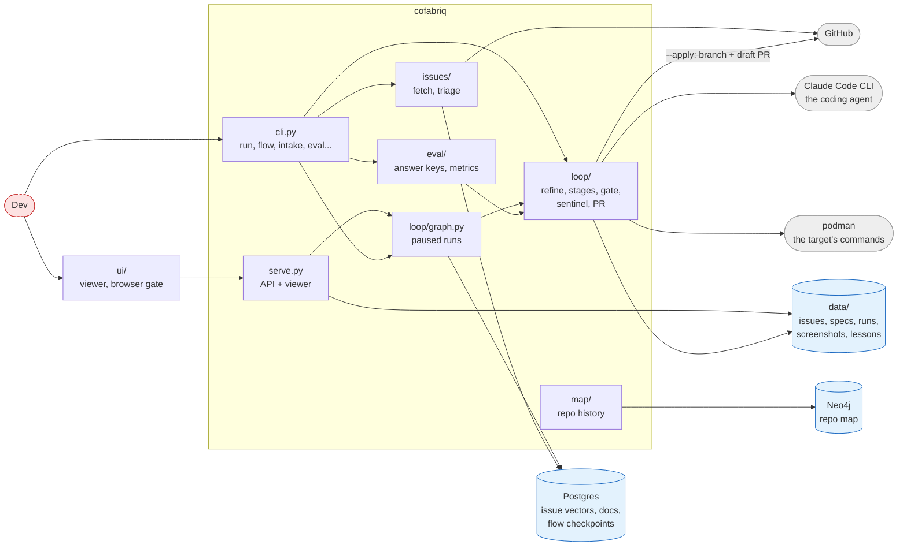
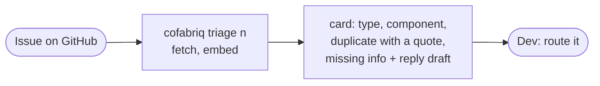
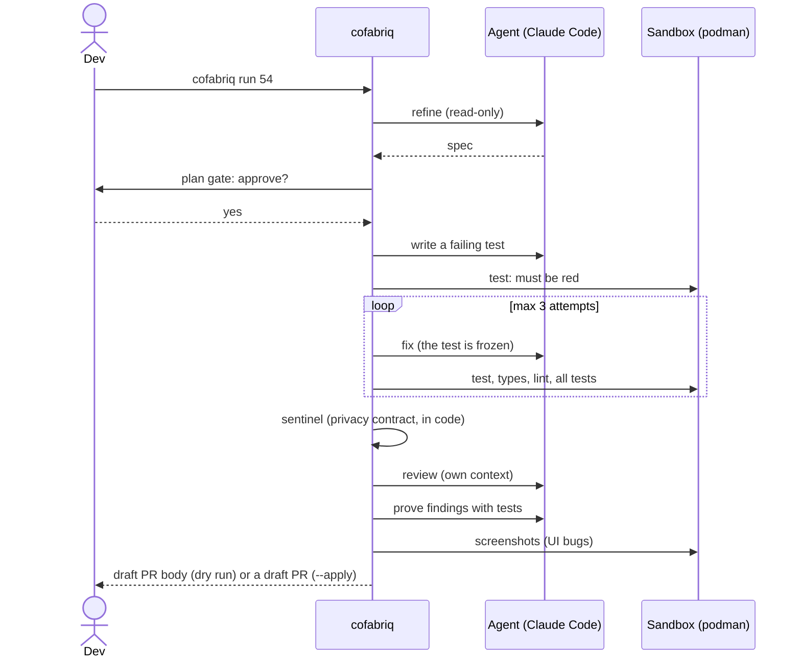
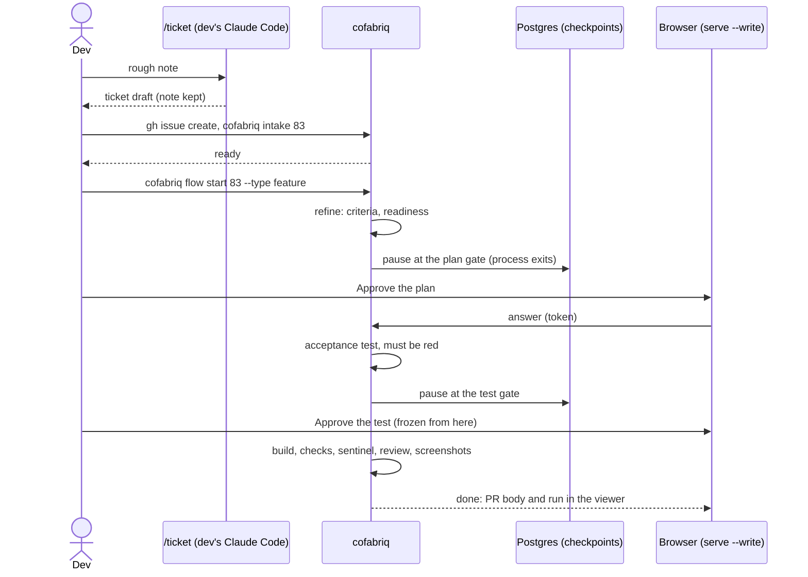
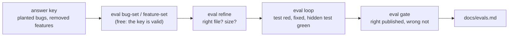
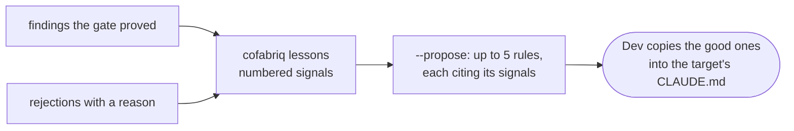

# Architecture: a map of the repository

What cofabriq does in one paragraph: an issue (a bug report or a small
feature request) comes in, an agent reads the code and writes a spec, the dev
approves it, an agent writes a test that fails first, another one changes the
code until the test and the project's checks pass, a separate reviewer checks
the change, and the dev gets a draft PR. Code the agents write only ever runs
in a container. Every stage is measured on a demo app with bugs planted and
features removed on purpose.

## The folders

| Folder | What's in it |
| --- | --- |
| `src/cofabriq/` | the Python package: the CLI and everything it runs (below) |
| `ui/` | the viewer and browser gate: Vite, React, TanStack Router + Query, shadcn; its API client is generated from `ui/openapi.json` |
| `targets/` | one TOML file per repository cofabriq works on: its components, how to install and test it, its risk tiers, its invariant (`[sentinel]`) |
| `playground/` | the demo app's answer keys: `seed.toml` (issues with expected labels), `bugs.toml` + `bugs/` (22 planted bugs, their repros and reference fixes), `features.toml` + `features/` (9 removed features), `hard.toml` + `hard/` (5 harder bugs), `playground.py` (seed or reset the demo repo) |
| `evals/` | frozen eval sets from real repos (issue numbers only): duplicates, missing info, impact |
| `tests/` | pytest, one file per module; fakes for the agent and the sandbox, no network |
| `docs/` | `adr/` (10 decisions), `evals.md` (every number), `how-it-works.md`, `intake.md`, this file, `demo/` (screenshots) |
| `skills/ticket/` | the `/ticket` Claude Code skill: a rough note into a ticket |
| `data/` | not in git: everything cofabriq fetches and produces (below) |

### Inside `src/cofabriq/`

| Module | Role |
| --- | --- |
| `cli.py` | every command (`triage`, `refine`, `run`, `flow`, `intake`, `serve`, `lessons`, `stop`, `eval ...`) |
| `config.py` | settings from `.env` |
| `context/` | the docs layer from the project's first version: fetch, parse, chunk, embed docs into Postgres, extract decisions into Neo4j; behind the MCP tools `search`, `decisions`, `affected` |
| `issues/` | GitHub issues in: the GraphQL source, the local store, vectors for duplicates, the triage card, the readiness check for missing info |
| `map/` | the repo map from git history: files to components, co-change, which commit fixed which issue; behind `impact` |
| `loop/` | the factory itself (below) |
| `eval/` | one module per eval: the planted sets, the metrics |
| `serve.py`, `serve_guard.py` | the HTTP API for the viewer and its trust boundary (Host, Origin, token) |
| `mcp_server.py` | the MCP tools for Claude Code |

### Inside `loop/`, in the order a run uses it

| Module | Step |
| --- | --- |
| `intake.py` | is the ticket blocked, is another cofabriq PR still open, is the spec ready |
| `refine.py` | issue -> spec (problem, files, criteria, plan, open questions, size), read-only agent |
| `graph.py` | the run as a LangGraph graph with pauses at the plan and test gates (`cofabriq flow`) |
| `run.py` | the stages: start (worktree, install), test (written first, must fail), build (fix attempts); write boundaries; screenshots |
| `engine.py` | the coding agent (`claude -p`, no shell), the kill switch, the run budget |
| `sandbox.py` | the target's commands in podman, network only for the install |
| `sentinel.py` | the target's invariant, checked in code before review |
| `gate.py`, `review.py` | the separate reviewer; a finding blocks only when a test proves it |
| `pr.py`, `publish.py` | risk tier and draft PR body; `--apply` pushes a branch and opens a draft PR |
| `lessons.py` | rules for the target's CLAUDE.md from what went wrong |

## The parts and where they keep things

### `data/` (local, not in git)

| Folder | Written by | Holds |
| --- | --- | --- |
| `data/issues/` | `fetch-issues`, `triage`, `run` | GitHub issues as JSON |
| `data/clones/` | `refine`, `run` | full clones of the targets (cofabriq's cache) |
| `data/work/` | the loop | one git worktree per run, removed afterwards |
| `data/refine/` | `eval refine` | specs (`eval-*` bugs, `features-*` features and hard bugs) |
| `data/runs/` | `run`, flows, evals | run records, PR bodies (`*.pr.md`), screenshots (`<run>/`) |
| `data/lessons/` | gate rejections, `lessons --propose` | rejection reasons, proposed rules |
| `data/STOP` | `cofabriq stop` | while it exists, no agent starts |

## User journeys

### 1. Triage an issue (0.1)

### 2. Fix a bug from the terminal (`cofabriq run`, 0.2)

### 3. A feature, approved in the browser (`cofabriq flow`, 0.3 to 0.5)

### 4. Measure (every version)

### 5. Learn from what went wrong (0.6)

### 6. Stop everything

`cofabriq stop` creates `data/STOP`; every agent checks it before it starts,
so runs and evals end at their next step with status `halted` (no retry spends
an attempt on it). `cofabriq stop --clear` lets them run again.

## Where to start reading

1. `README.md`, then this file.
2. `docs/how-it-works.md`: each step in prose.
3. `docs/adr/006` to `010`: the decisions that shaped the loop.
4. Code, in the order of journey 2: `loop/refine.py`, `loop/run.py`
   (`start_stage` to `pack`), `loop/engine.py`, `loop/sandbox.py`,
   `loop/gate.py`, `loop/sentinel.py`, `loop/pr.py`; then `loop/graph.py` and
   `serve.py` for journey 3.
5. `targets/philippmossier-local-ai-chat-playground.toml`: everything the loop
   knows about a target, in one file.
6. `docs/evals.md`: the numbers and what they don't show.
