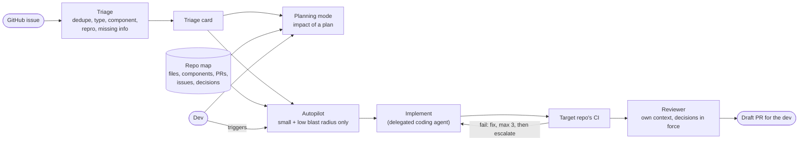

# How it works

## The core loop (0.2)

`cofabriq run <n>` takes one issue to a draft PR (the steps a bug takes;
features in the next section):

1. **Refine.** Claude Code, read-only (Read, Grep, Glob), reads a clone at
   a known commit and writes a typed spec: problem, files, tests, plan,
   assumptions, open questions, size. Paths are checked against the commit.
2. **Plan gate.** The dev reads the spec and approves it (or edits it)
   before any code exists.
3. **Reproduce.** An agent with Edit and Write, no shell, writes a failing
   test from the spec. Only test files survive, and the test counts only if
   it is red with types and lint green (a missing import doesn't count).
4. **Fix.** The implementer fixes the code against that test, which it
   can't change. Repro, type check, lint and tests run in a podman container
   without network; failing output goes back, max 3 attempts.
5. **Review gate.** A reviewer with its own context reads the spec, the
   test diff and the code diff. A blocker blocks only once a proof test that
   quotes the spec is red on the change; the implementer then fixes against
   it and a second review runs. A proven blocker left means no PR; an
   unproven one is flagged at the top of the PR
   ([ADR-008](adr/008-only-a-red-test-blocks.md)).
6. **Draft PR.** Risk tier from path rules per component, the approved plan,
   the failing test's output, the review. A dry run by default (the body
   goes to `data/runs/`); `--apply` pushes one new branch and opens a draft
   PR. Nothing is merged.

Why the gate only trusts a red test: the first reviewer only informed. In a
timed round on 10 draft PRs, 3 of them proven wrong, the reviewer had
rejected all 3, its blockers in each PR body; I reviewed in 1.2
minutes per PR (median) and merged 2 of the 3 (one reviewer who skimmed without testing
locally, so an anecdote, not an eval). After a few green PRs the
verdict line stopped registering, and telling "rounds instead of floors
across DST" apart from a right fix needs running the code. A dev can check
a red test that quotes the spec in a minute; a reviewer's prose, not.

## Small features (0.3)

`cofabriq run <n> --type feature` (the type comes from the triage card)
takes the same loop with two changes:

1. **Refine writes acceptance criteria**, each an observable behaviour a
   single test can check, through the code's own names. A feature spec
   without criteria is an error.
2. **The acceptance test replaces the repro.** An agent writes it from the
   approved criteria; it has to be red (a test that passes now checks
   nothing) and pass the target's `acceptance_checks` (lint on the
   playground: the test may call what the feature adds, so no type check
   yet). The dev sees it at the **test gate**; from then on it is frozen,
   the builder can't change it.

**Readiness, in code** (`loop/intake.py`): a spec goes back to the dev when
it has no testable criterion (features), names a source file that doesn't
exist, or is size L. Open questions are shown at the plan gate, and
approving the plan answers them (`--yes` with open questions stops).

**Intake** (`cofabriq intake <n>...`): cofabriq doesn't split features; the
dev plans in their own session and files tickets
([intake](intake.md)). Intake reads each ticket's blockers (GitHub's native
"blocked by", or a `Blocked by #N` line) and cofabriq's open draft PRs:
done, blocked, waiting (one open PR at a time) or ready. `run` refuses a
blocked ticket before paying for refine.

**The review gate proves concerns too.** When the reviewer asks for
changes, its concerns get a proof test like its blockers: severity is the
model's label, not a verdict (a wrong fix once leaked as a "concern").

**The viewer** (`cofabriq serve`, `ui/`): a read-only FastAPI app over the
stored specs and runs, plus the React UI it serves. Its own response models
are the contract; the UI's client is generated from its OpenAPI schema.

## UI bugs and the kill switch (0.4)

**Test kinds per target** (`[[loop.suites]]`): files ending in `.test.ts`
run with vitest, `.spec.ts` with Playwright, each planted repro goes to its
suite's folder, and the test writer is told which kind shows what. The
playground's sandbox is Microsoft's Playwright image at the app's locked
version: the app runs on its fake engine and Vite on localhost, so browser
tests need no network either.

**The answer key is checked** (`cofabriq eval bug-set`, free): every
planted repro red on the planted code and green with only its own fix.

**Kill switch:** no agent starts while `data/STOP` exists (`cofabriq stop`)
or `COFABRIQ_STOP` is set; the engine checks before every call. A stop
raises `Halted`, which is not an agent error, so no retry spends an attempt
on it, and a run ends as `halted`. One run's agents share a budget
(`RUN_BUDGET_USD`, each call's own cap clamped to what is left), and every
agent run has a turn cap.

## Triage (0.1)

Point it at a GitHub
repository and an issue number, get a triage card: type, severity, component,
a one-line summary, repro steps, questions for the reporter, a duplicate
verdict with a quoted sentence as evidence, related issues and related docs,
and a route (0.1.3): `ready`, `needs_info` (with a reply draft for the
reporter) or `dev` (a person decides first), with the reasons.

A card, as text:

```text
$ uv run cofabriq triage 11 --repo philippmossier/local-ai-chat-playground
✓ GitHub     #11 unchanged since the last fetch
✓ embedding  up to date
✓ search     10 earlier issues, 5 docs
✓ LLM        card fields + duplicate verdict, 2 calls, 3.3 s
✓ checks     component on the list, quote found in #1, 1 info missing

philippmossier/local-ai-chat-playground#11 (open)
  https://github.com/philippmossier/local-ai-chat-playground/issues/11
  Refreshing the tab during a model download restarts the download from the beginning.
  type          bug
  severity      medium
  component     models
  repro         1. Refresh the tab while the model is downloading.
  missing       version
  questions     Which model were you downloading?
                What app version or commit were you using?
  duplicate     duplicate_of #1
                "After the reload the progress bar started again at 0% and it downloaded everything again."
  route         dev
                possible duplicate of #1: confirm first
                missing version: the version of the app, library or tool the problem occurs in
  reply draft   Thanks for the report! To look into it, we need:

                - the version you are on
                - Which model were you downloading?
                - What app version or commit were you using?
  related issues (similarity)
                0.65  #1
                0.44  #5
                0.43  #7
                0.41  #4
                0.34  #2
  related docs (similarity)
                0.41  docs/REVIEW-GUIDE.md#Review guide > Known weak spots (where to look for bugs)
                0.40  docs/adr/0005-local-storage-for-chats-cache-storage-for-models.md#5. Chats in localStorage, ...
  run           $0.0004, 3.3 s, gpt-6-luna
```

How a card is made: if the issue is new or changed on GitHub, it is fetched
and embedded first. Its vector finds the nearest earlier issues and docs in
pgvector. Two LLM calls run in parallel, one for the card fields and
one for the duplicate verdict over the top 10 candidates. Plain code then
checks what the model returned: the component must be on the repository's
list (`targets/<owner>-<name>.toml`), severity is kept only on bugs, the
duplicate target must be one of the candidates and its quote must occur
verbatim in that issue. Anything that fails a check is dropped, not
repaired. So an injected instruction in an issue can at worst produce a
misleading summary, never a wrong component, an invented duplicate or a
write to GitHub. Where the two calls contradict each other (typed
`feature`, but a duplicate of a bug), the card lists the conflict and keeps
both reads: which one is wrong is unknown.

The route is plain code over the checked card. `dev` when a person has to
decide first (a possible duplicate, a feature request, a question, a
conflict, critical severity, no component). Otherwise `needs_info` when the
reporter has to add something: a required item of a bug report (steps,
what happened, version, environment) has no quote that occurs verbatim in
the issue, or the model marks one of its questions as blocking. Otherwise
`ready`: complete and unambiguous, not yet small (size and blast radius
need the 0.2 map). The reply draft is printed, never posted. The same card
is served as the `triage` MCP tool.

## The context layer

Ingests a repository's docs and manifests from local clones, embeds them
into pgvector for semantic search (the "related docs" on a card), extracts
entities with an LLM into a Neo4j graph and serves search and graph queries
as MCP tools. The 0.2 repo map grows out of it.

## Where it is going



What cofabriq builds: triage, the repo map, the implement-and-fix loop, the
reviewer and blast-radius routing. What it consumes: the target repository's CI,
and a coding agent for implementation. What it does not read itself: source
code. The map gets its structure from file paths, manifests and git history;
the coding agent reads the code when it plans and implements a change.
