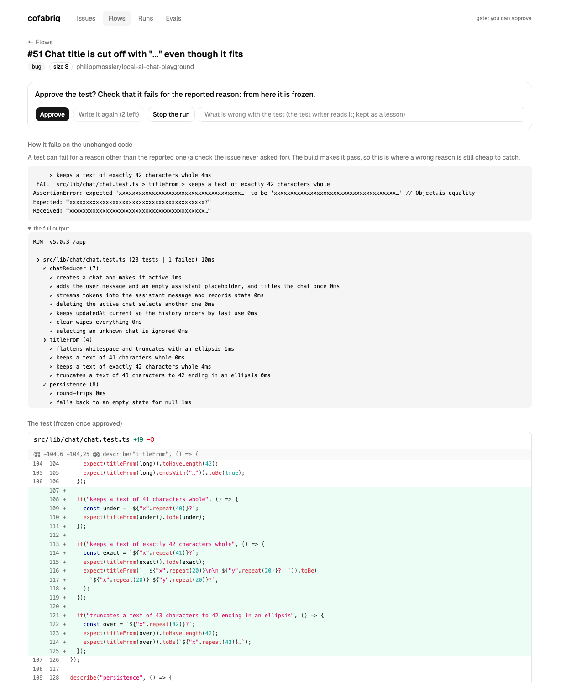
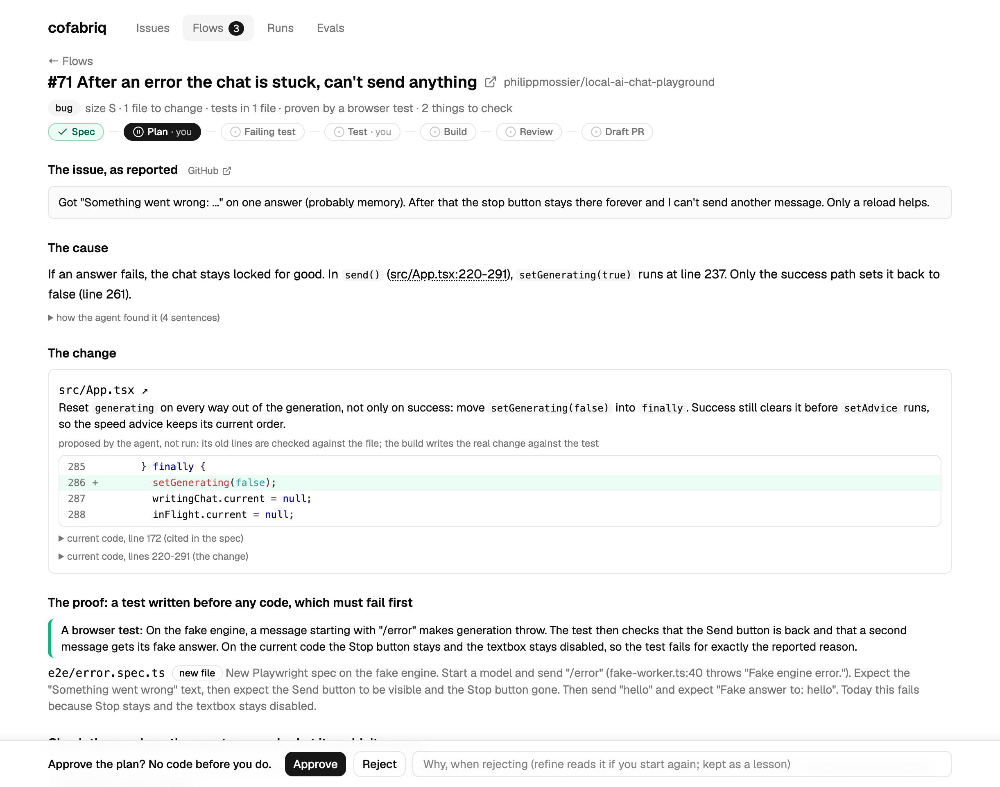
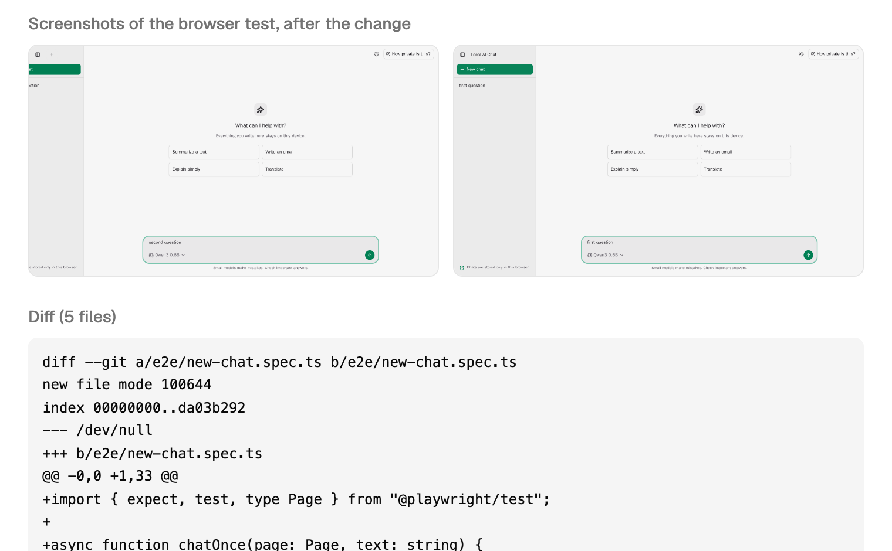
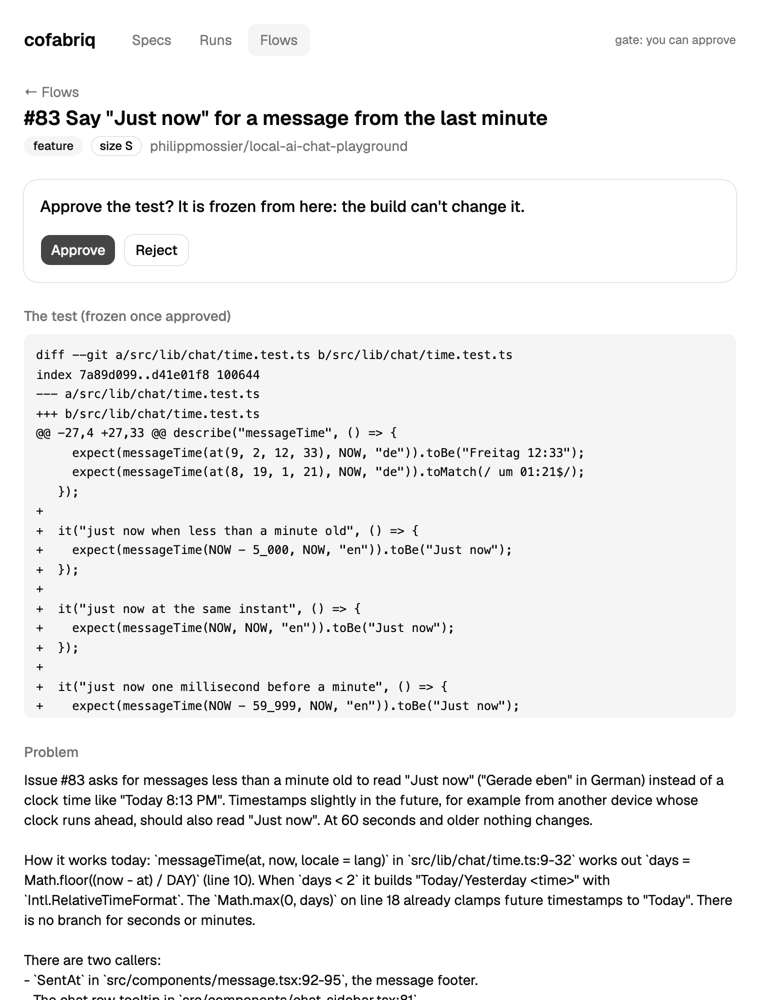
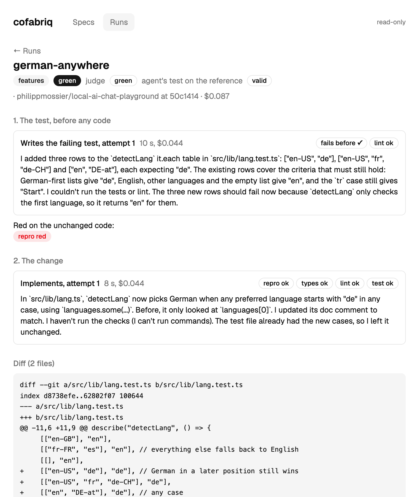

# What each version added

One real example per version, newest first. Release notes:
[GitHub releases](https://github.com/philippmossier/cofabriq/releases);
numbers: [evals](evals.md).

## A test you can judge, started from the browser (0.8)

A green test only means something if it first failed for the reported
reason. Playground [#8](https://github.com/philippmossier/local-ai-chat-playground/issues/8)
says code in dark mode is "dark grey on almost black". The agent's browser
test checked four things, the page's `color-scheme` first, and said so:

> It should fail now because nothing sets `color-scheme` [...]. The colour
> and contrast checks also catch the reported dark grey if Chrome's computed
> colour shows it. I haven't been able to run it.

It failed on `color-scheme`, the fix made it green, and the reviewer
approved with a note: "'failed before' does not prove the grey text was
reproduced". On a bug, nobody saw the test before the build. Now every run
stops there:

1. **Start it in the browser.** Under Issues, pick
   [#51](https://github.com/philippmossier/local-ai-chat-playground/issues/51)
   (a chat title cut off with "…" although it fits) and press Start. The
   step view shows each step live: what ran, how long, what it cost, and on
   request the data it got and gave, the code behind it and why it exists.
2. **The plan gate** shows the lines the change will touch (checked against
   the file), a sketch of the edit (kept only if its old lines are really
   there), and how the fix will be proven: a unit test, a browser test, a
   stand-in measure, or no test at all, which goes back to the dev before
   any test is paid for.
3. **The test gate** shows how the new test fails on the unchanged code:
   only the failure lines, the full output folded. Approve, stop, or **write
   it again** with a reason. #51's first test was sent back with "also test
   a title one character shorter than the limit"; the second one added that
   case, and was approved.
4. Build, checks, review and the draft PR body, as before. #51 took 1 min
   53 s and $0.38 (API list price), the rewrite included.



On the 22 planted bugs, refine now plans a test for every one (19 before),
lists only files the fix touches (precision 0.91 to 1.00), and names the
fix's own lines in 18; it picks a unit test for 10 and a browser test for
12, and turns none away ([numbers](evals.md#08-specs-and-tests-you-can-judge)).
Why a rejected test goes back to the test writer and not to refine:
[ADR-010](adr/010-langgraph-for-the-outer-loop-gates-as-nodes.md).

**0.8.1: a plan gate you read top to bottom once.** Playground
[#71](https://github.com/philippmossier/local-ai-chat-playground/issues/71):
after an error the chat stays locked. A stepper says where the run is, the
issue sits above the spec, the cause leads in two sentences (the evidence
folded), the sketch shows only the line it adds, and Approve stays in a bar
at the bottom of the window. A bug's test is now planned as cases, each
marked "fails now" or "must stay", and the test writer gets them, so the
test it writes is the one you approved.



On the 6 planted bugs it was measured on, every spec had a case that fails
now (24 cases in all), and the fix's file was still listed first on all 6
([numbers](evals.md#081-the-planned-test-as-cases)).

## Learning from what went wrong (0.6)

**Rules from failures, not up front.** `cofabriq lessons` collects what the
factory already knows went wrong: findings the review gate proved with a
failing test, and plans or tests the dev rejected, with the reason they
gave. `--propose` turns them into at most 5 rules for the target's own
CLAUDE.md, each citing the signals it comes from (a rule citing nothing
real is dropped in code). On the demo app, 36 signals became 5 rules (all 36
come from the 8 fixes that were written wrong on purpose, since the loop makes
no natural mistakes on these sets); the first one:

> When a task comes with a spec, make exactly the change it describes [...].
> Do not add your own heuristics, extra conditions or different units [...].
> If you think the spec misses a case, leave the code as specified and raise
> the case as an open question in your summary.

It's a draft for the dev; nothing is written into the target. Whether a
rule stops the mistake from coming back isn't measured yet.

**The app's contract, checked in code.** The demo app promises that nothing
typed leaves the device, and its Content-Security-Policy lists the only
hosts it may talk to. Every change is checked against that list before a
reviewer is paid for: a new URL to another host, or any change to the
policy, blocks the run with the line as evidence. On the 50 right changes
stored so far: 0 false alarms.

**Screenshots of the browser test.** After a UI fix goes green, the agent's
browser test runs once more with screenshots on; the viewer shows them and
the PR body says so.



Also in 0.6: a harder planted set (symptom-only tickets, causes in data, a
shared helper, two files), and it wasn't harder for the model: 5 of 5 fixed
on the first try. It stays as a regression check.

## From a fuzzy note, approved in the browser (0.5)

A rough note, the kind the `/ticket` skill takes:

> just sent msg shows "Today 8:13 PM", would be nicer to say "just now"
> for the first minute (german: gerade eben). other devices clock can be
> a bit ahead

Following the skill's rules (the note kept verbatim, nothing invented) it
became
[#83](https://github.com/philippmossier/local-ai-chat-playground/issues/83),
and then:

1. `cofabriq intake 83`: ready (no blocker, no open cofabriq PR).
2. `cofabriq flow start 83 --type feature`: refine writes 8 acceptance
   criteria (under 60 s "Just now", 59,999 ms still, 60 s not, a clock
   slightly ahead, German), and the run **stops at the plan gate**. The
   process exits; the run waits in Postgres.
3. In the browser (`cofabriq serve --write`): **Approve the plan.** The
   agent writes the acceptance test, it fails on the current code, and the
   run stops again at the **test gate**.
4. **Approve the test.** From here it's frozen. The build is a two-line
   early return, the checks and the review gate pass, and the draft PR
   body lands in the viewer. $0.14 for test and build (API list price).



Each pause is a step boundary of a LangGraph graph checkpointed in
Postgres, so a run can wait for hours, in another process
([ADR-010](adr/010-langgraph-for-the-outer-loop-gates-as-nodes.md)).
Approving needs the token `serve --write` prints once; any other page in
the browser is refused.

## UI bugs (0.4)

Some bugs only show in a browser. A user filed this one:

> The placeholder says Shift+Enter for a new line, but Shift+Enter sends
> the message immediately. I wanted to paste a list with line breaks.

The agent writes its failing test as a browser test this time, run by
Playwright in the same isolated container, against the app on a fake
model:

```ts
test("Shift+Enter breaks the line instead of sending", async ({ page }) => {
  // ...
  await box.fill("first line");
  await box.press("Shift+Enter");
  await box.pressSequentially("second line");
  await expect(box).toHaveValue("first line\nsecond line");
  await expect(page.getByText(/Fake answer to:/)).toHaveCount(0);
  // ...
});
```

It fails on the current code, the fix is one condition (`!e.shiftKey`),
and the bug's own hidden test passes on it. About 2 minutes and $0.17
(API list price). A target names its test kinds (unit tests for logic,
browser tests for the UI) and the agent picks the one that can show the
bug.

## Features (0.3)

The same loop takes a small feature request. One of the demo app's
features was taken out on purpose, and its ticket asks for it back:

> My browser languages are English (US) first and German second. The app
> shows English because only the first language counts. I can read both,
> but I'd prefer German.

1. **An agent reads the code and writes acceptance criteria**, each one a
   behaviour a test can check: `detectLang(["en-US", "de"])` returns
   `"de"`; `detectLang(["en", "DE-at"])` returns `"de"` (any case); German
   first, English, other languages and the empty list stay as they are.
   Seven in all.
2. **The dev approves the plan and the criteria.** A spec that names no
   testable criterion, a file that doesn't exist or a size too big for one
   PR goes back to the dev with the reason; open questions are answered
   at this gate.
3. **An agent writes the acceptance test from the criteria:** three new
   rows in the existing `detectLang` table. It fails on the current code,
   so it tests something. **From here it is frozen:** the agent that
   builds the feature can't change it.
4. **An agent builds the feature** (one line: `languages.some(...)`
   instead of `languages[0]`) until the test and the project's checks are
   green.
5. **The review gate and the draft PR** as for bugs (in `cofabriq run`;
   the feature evals stop at the build, so the gate isn't measured on
   features yet).

About 2 minutes and $0.25 (API list price) for this feature. The feature's own original
tests, hidden from the agents, pass on the result.



**The viewer** (`cofabriq serve`, read-only, local): every spec with its
criteria and readiness, every run from the failing test to the review
gate's proofs and the PR body. Self-hosted by design: it runs where the
code is, with your keys ([ADR-009](adr/009-self-hosted-not-saas-ui-in-the-repo.md)).

## Triage (0.1, 0.7)

Before any of that, an issue gets a triage card: type, component, a
duplicate verdict with a quote as evidence, missing info with a reply
draft for the reporter. Measured on real issues of
[microsoft/vscode](https://github.com/microsoft/vscode) and
[open-webui](https://github.com/open-webui/open-webui).

Duplicate candidates come from the issue's embedding, made from its title and
body with the template, the reporter's system blocks, checkboxes and long logs
cut out first. One more LLM call then picks the verdict's 10 candidates from
the 50 nearest earlier issues (about $0.0007 and 3 s per card;
`RERANK_CANDIDATES=false` in `.env` turns it off). The exact duplicate is then
in the shortlist far more often: top-10 recall 0.40 to 0.635 on vscode and
0.568 to 0.703 on open-webui. The final verdict does not improve on both yet,
but the card lists the top 5 candidates and a human decides, so recall comes
first ([numbers](evals.md#07-cleaner-issue-text-a-reranker)).


